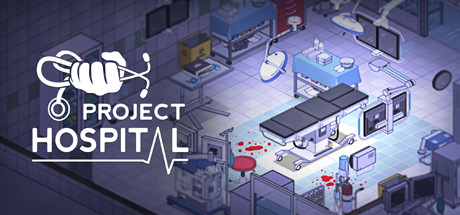

**Project Hospital is the deeply detailed hospital management simulator where you design ward layouts, hire specialized medical staff, manage diagnoses, and treat patients across dozens of medical departments. Features realistic medical procedures.**

---

## 📖 About

Project Hospital is the deeply detailed hospital management simulator where you design ward layouts, hire specialized medical staff, manage diagnoses, and treat patients across dozens of medical departments. Features realistic medical procedures.

## ⚠️ Problems Without Trainer

| Problem | Status |
|---------|--------|
| **Staff Specialization** — Assigning doctors and nurses to correct departments requires planning | ✅ Solved |
| **Patient Flow** — Poor layout design creates treatment bottlenecks that overwhelm departments | ✅ Solved |
| **Diagnosis Chains** — Rare conditions require multiple specialized departments before identification | ✅ Solved |
| **Financial Timing** — Major capital purchases must be timed around insurance payment cycles | ✅ Solved |

## ✅ Solution

The **Project Hospital Trainer** solves all these issues by giving you complete control over the game.

## 🎯 Full Feature List

- Unlimited Resources
- God Mode / Invincibility
- Instant Skill Cooldown
- One-Hit Kill
- Freeze Game Timer
- Unlock All Items & Achievements
- Custom Speed Multiplier
- Save State Anywhere

## 🚀 Quick Start

1. **Disable Windows Defender** temporarily (trainer may trigger false positive)
2. Download the trainer from the button above
3. Launch Project Hospital
4. Run the trainer as Administrator
5. Activate desired cheats with hotkeys

## 💎 Free vs Paid

| Feature | Free | Pro |
|---------|------|-----|
| Basic God Mode | ✅ | ✅ |
| Unlimited Resources | ✅ | ✅ |
| All Advanced Cheats | ❌ | ✅ |
| Auto-Updates | ❌ | ✅ |
| Priority Support | ❌ | ✅ |

## 💻 Requirements

- Windows 10/11 (64-bit)
- Project Hospital (any version)
- .NET Framework 4.8+
- DirectX 11+

## 🍎 macOS

macOS users can use our alternative tool:

## ⚖️ Legal

This trainer is for educational and single-player use only. Use responsibly.

---

